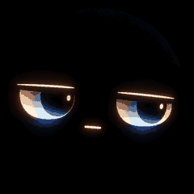

# MacDesk Buddy · Physical AI Exploration

**First build:** a compact, original, Mac-first desk companion with a **1.28-inch circular GC9A01 full-color IPS face**, an ESP32-S3, optional motion sensing and a printable case. Inspired by the saved robotics Reels without copying creators' assets.

[](https://github.com/imaddde867/physical_AI_exploration/actions/workflows/python-tests.yml) [](https://github.com/imaddde867/physical_AI_exploration/actions/workflows/firmware-build.yml) [](https://github.com/imaddde867/physical_AI_exploration/actions/workflows/cad-check.yml)



**One character only.** The earlier pastel/emoji-like gallery is replaced by a single heavy-lidded, neutral face. Firmware reads this exact screen-only [240×240 PNG](assets/face-idle-240.png) through an automatic RGB565 sprite compiler. There is no character sheet, childlike artwork or robot enclosure in the display asset.

**Display fidelity:** the sprite source is 32-color indexed at native screen resolution. Its reproduction on the actual LCD—colors, backlight, rotation and physical appearance—has not yet been tested.

> **Compare before purchasing:** [All worthwhile options: Reel-matched vs online alternatives](docs/hardware-options.md) · [Mac first-20-minutes clone/run guide](docs/clone-and-run.md) · [Actual screen-to-case dimensions](assets/actual-scale-front.svg). The image above is the **exact 240×240 source**, enlarged on your screen. The real device's viewing diameter remains ~31.4 mm.

> **Status:** Python unit tests, repository metadata verification and both ESP32 USB firmware builds run in CI; OpenSCAD geometry has its own CI workflow. The round CAD was rendered and mesh-checked, but **real LCD illumination, physical fit, Bambu slicing and assembly are not validated**. See [audit and evidence](docs/audit-2026-10-26.md).

## Why this build?

A USB-powered **ESP32-S3** renders full-color expressions over **SPI**, while the **MacBook M4** hosts commands and future optional local AI. The optional **MPU-6050** uses a **separate I²C bus** for motion-triggered reactions. The starter avoids cloud accounts, microphones, cameras and motors. Start with the electronics you can understand and validate, then expand.

```text
 MacBook Pro (Python host, optional local LLM)
           | USB serial / newline JSON
           v
 ESP32-S3 MCU --> SPI GC9A01 round IPS (color animated face)
           |
       \--> I2C MPU-6050 (optional motion sensor)
       later expansion: servo, voice, Wi-Fi
```

## Start here

1. Start with [clone and first-run instructions](docs/clone-and-run.md), then review [physical build steps](docs/first-build.md) and the [verified-priced parts basket](docs/bom.md).
2. Without hardware: `python3 -m unittest discover -s tests -v` and `python3 -m macdesk.demo --simulate --face neutral`.
3. With hardware: follow [firmware/README.md](firmware/README.md) and flash the ESP32-S3.
4. Connect a **data-capable USB cable to the board's native ESP32-S3 USB/OTG port (not its CH343P UART port for the default firmware)**, find the port, then run `python3 -m pip install -r requirements.txt` and `python3 -m macdesk.demo --port /dev/cu.usbmodemXXXX --face neutral`.
5. Print the small **screen fit coupon** first, then render `cad/desk-buddy.scad` with **OpenSCAD** after measuring actual components. See [docs/printing.md](docs/printing.md).

## Project map

| Area | What you'll find |
|---|---|
| [docs/first-build.md](docs/first-build.md) | Steps, safety, acceptance tests |
| [docs/bom.md](docs/bom.md) | One small first-build basket |
| [docs/hardware-options.md](docs/hardware-options.md) | Creator/Reel-matched vs available online kits (important: **not plug-and-play compatible**) |
| [hardware/options.json](hardware/options.json) | Machine-readable hardware options and source links |
| [hardware/bom.json](hardware/bom.json) | Auditable shopping basket prices and assumptions |
| [docs/clone-and-run.md](docs/clone-and-run.md) | Reproducible MacBook software-only start |
| [docs/reel-index.md](docs/reel-index.md) | Nine-video quick reference and original sources |
| [docs/reel-technical-notes.md](docs/reel-technical-notes.md) | Complete practical engineering notes and build paths from all nine saved videos |
| [docs/printing.md](docs/printing.md) | Printable enclosure and fit test |
| [docs/architecture.md](docs/architecture.md) | JSON protocol, responsibility boundaries |
| [firmware/](firmware/) | Original PlatformIO Arduino ESP32-S3 implementation |
| [macdesk/](macdesk/) | macOS-friendly Python controller + simulator |
| [cad/](cad/) | Source-controlled, adjustable OpenSCAD enclosure |
| [assets/architecture.svg](assets/architecture.svg) | Original vector architecture visual |
| [assets/actual-scale-front.svg](assets/actual-scale-front.svg) | Honest physical face-to-case proportions |
| [assets/face-idle-240.png](assets/face-idle-240.png) | Actual single-face screen sprite |
| [tools/face_asset.py](tools/face_asset.py) | Deterministic dependency-free PNG to RGB565 compiler |
| [tools/check_repository.py](tools/check_repository.py) | Offline BOM/links/catalogue consistency checks |

## Roadmap

- **V0 (now):** simulator, original JSONL protocol, **one understated GC9A01 character with restrained moods**, occasional blinking, optional MPU-6050 shake reaction, printable circular enclosure and fit coupon.
- **V1 (hardware):** verify wiring + fit; measure time-to-expression and reconnect behavior.
- **V2:** optional Mac-local LLM/voice and a constrained face-action interface; additional physical sensors only as needed.
- **V3:** measure model-to-action reliability, latency and memory; introduce bounded movement with a separately rated motor power supply.
- **V4:** camera or richer perception experiments and independent hardware sensing.
- **V5:** optional standalone Wi-Fi mode; compare Mac-hosted vs edge-only behavior.

**Current software only supports the GC9A01-based first build.** Taby, Waveshare AMOLED boards, Rocky and StackChan are documented **alternatives**, not build targets for the existing firmware. **No language model runs in V0**. Mac-local model/tool integration is V2/V3 work, and ESP32 keeps deterministic sensor behavior. The M4 laptop should remain responsive; GPU machines are **optional for training**, not required at runtime. No cloud dependency is required for V0/V1. No third-party images, firmware or CAD assets have been copied.

## Attributions and licensing

See [docs/reel-index.md](docs/reel-index.md). Original repository material is MIT licensed under [LICENSE](LICENSE). Linked projects retain their authors' licenses and restrictions. This is an independently designed learning project.

## Latest review

- [Technical audit (26 October 2026)](docs/audit-2026-10-26.md)
- [Verified vendor part list](docs/shopping-list.md)
- [Original pin-level wiring diagram](assets/wiring.svg)
- [Round color display choice and sourcing](docs/display-choice.md)
- [Original concept face gallery](assets/face-preview.svg)
- [Issue #1: actual hardware bring-up](https://github.com/imaddde867/physical_AI_exploration/issues/1)
