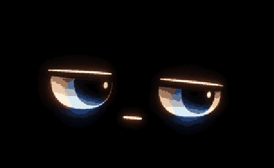
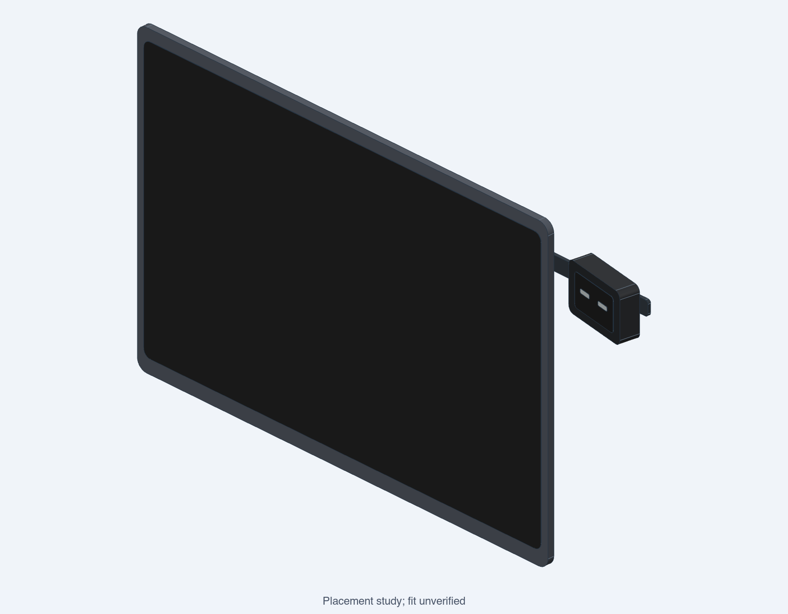

# MacDesk Buddy

A quiet, expressive assistant beside your MacBook. One character, subtle reactions, and a small landscape display.

<p align="center">
  
</p>

[](https://github.com/imaddde867/physical_AI_exploration/actions/workflows/python-tests.yml)
[](https://github.com/imaddde867/physical_AI_exploration/actions/workflows/firmware-build.yml)
[](https://github.com/imaddde867/physical_AI_exploration/actions/workflows/cad-check.yml)

**Status:** the 456×280 face, offline preview and separate Waveshare V2 bench firmware are implemented. Software tests and firmware builds pass. No board has been purchased or physically tested; the fitted enclosure and Mac event integrations remain unfinished.

## Try it on your Mac

```sh
git clone https://github.com/imaddde867/physical_AI_exploration.git
cd physical_AI_exploration
open assets/amoled-preview.html
```

The preview opens directly in Safari. Choose an expression, hold a blink, scrub time or play the fixed 12-second loop. It uses the firmware's RGB565 pixels and needs no hardware, server, model or installation.

## Live desktop simulator

Any mini-app (a Python file defining `update(screen, t_ms)`) runs pixel-exact in a desktop window:

```sh
sim/run.sh experiments/hello_buddy.py --fps 60 --scale 2
```

The launcher picks a Tcl/Tk that renders on this Mac; the system Python's bundled Tk can open windows that stay blank (known Tk 8.6.8 macOS issue).

The face preserves the [original character](assets/face-idle-240.png): heavy lids, cool textured eyes, warm highlights and a small mouth. Six restrained moods share the same identity: neutral, happy, sad, sleepy, surprised and thinking.

## Selected build

**Waveshare ESP32-S3-Touch-AMOLED-1.64 V2, SKU 31197**, powered and controlled over one USB data cable. The intended placement is near the upper-right side of the MacBook lid, in a removable landscape head.



*The placement render uses placeholder eyes. Board fit, cable routing, retention and the detachable mount still need physical measurements.*

| Track | Use |
|---|---|
| [AMOLED V2](firmware-v2/README.md) | Selected board: separate ESP-IDF renderer, USB face commands, local blink and idle dim/blank |
| [GC9A01 prototype](firmware/README.md) | Earlier round 240×240 learning build; preserved with its own firmware and wiring |

The firmware images are hardware-specific. Run the [pinned official V2 example](https://github.com/waveshareteam/ESP32-S3-Touch-AMOLED-1.64-v2/tree/21b952243d306692774f3b5bfeb3eb5cff10f851) first when the board arrives. Compilation does not establish illumination, orientation, colors, brightness or sustained display behavior.

[Buying decision](docs/build-decision.md) · [Build plan](docs/rectangular-build-plan.md) · [Printing and clearance coupon](docs/printing.md) · [Readiness](docs/release-readiness.md)

## Develop and validate

Python **3.11+** is required for repository checks. See [Mac setup](docs/clone-and-run.md) if your system Python is older.

```sh
python3 -m unittest discover -s tests -v
python3 tools/check_repository.py
python3 -m tools.amoled_face
```

[Build the V2 firmware](firmware-v2/README.md#build-do-not-infer-a-working-screen) · [Validation evidence](firmware-v2/VALIDATION.md) · [Protocol and architecture](docs/architecture.md)

Development host: 14-inch MacBook Pro M4 (Mac16,1), 16 GB unified memory. No local LLM or cloud account is required. [Host details](docs/development-host.md).

## Next milestones

Validate the received board, measure the enclosure and mount, then add deterministic Mac events such as timers and battery status. Short text, music reactions and optional Mac-local intelligence remain planned. Touch, voice, camera and motors are outside the current implementation.

[CAD studies](cad/peeking-concepts/README.md) · [Hardware research](docs/hardware-options.md) · [Video reference index](docs/reel-index.md) · [Technical notes](docs/reel-technical-notes.md)

## License

Independently authored research prototype. Project code is [MIT licensed](LICENSE); the bundled V2 vendor driver retains [Apache-2.0](firmware-v2/src/vendor/LICENSE). Linked projects retain their own licenses and artwork restrictions.
