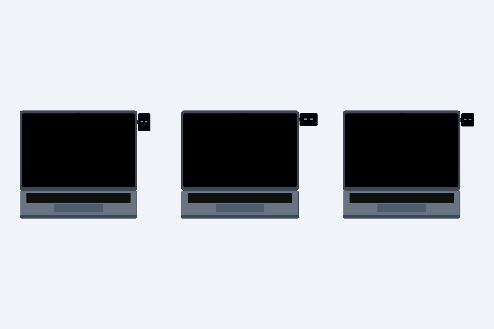
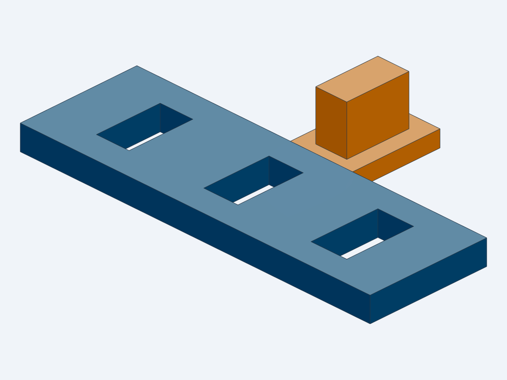

# Peeking companion — concept studies

**Current direction:** matte rounded rectangle, one USB power/data cable, Bambu Lab H2S. Start with the [rectangular engineering study](../../reports/Rectangular%20buddy%20engineering%20study.md) and [build plan](../../docs/rectangular-build-plan.md). The round studies below are earlier alternatives.

**Throwaway appearance and mechanism exploration, not print-ready pieces.** The original intent was a small round face looking at the user from beyond the left, right or top edge, supported entirely from behind the MacBook lid. For travel, compare retracting the pod behind the lid with removing the pod/arm while leaving a small dock attached. The user has not selected either mechanism.

## Scale and assumptions

Apple lists the **2024 14-inch M4 MacBook Pro** at **312.6 mm wide, 221.2 mm deep, 15.5 mm closed height**. These are overall dimensions, not a lid drawing. Source: [Apple specifications](https://support.apple.com/en-gb/121552).

The CAD uses those overall width/depth/closed-height values. **214 mm lid height, 4.5 mm lid thickness, corner radii, bezel, keyboard, trackpad and camera placement are appearance assumptions**, requiring measurements. The lid is shown upright for comparison; this is not a hinge/closure simulation. A 302.4 × 196.4 mm screen rectangle comes from the published pixel count and density and omits the notch/rounded corners.

The generic pod is **44 mm diameter × 13 mm deep**, with a **33.5 mm screen placeholder**. It is not a measured Waveshare PCB, enclosure or internal layout. Eyes are geometry placeholders, not the final digital artwork. Display, controller, connectors and cable space still need a component layout.

All accessory geometry stays behind the lid's rear reference plane. Deployed circular pods clear the chosen edge by 3 mm in this simplified model. A nominal 1 mm layer under the rear dock represents an unresolved attachment interface. No adhesive, skin, magnet, latch or clamp has been selected or validated. The bare aluminum lid is not assumed to retain a magnet.

## Models

| Source in `src/` | Output in `STEP/` | Question |
|---|---|---|
| `placement_study.py` | `placement_study.step` | How does left/right/top placement look at laptop scale? |
| `retractable_study.py` | `retractable_study.step` | Can the face slide behind the lid for carrying? |
| `detachable_study.py` | `detachable_study.step` | Is a removable face/arm with a small persistent dock simpler? |

Build each source with the installed pinned runtime from the repository root, for example:

```sh
uvx --no-config --managed-python --python 3.13 --from cadgen==0.7.26 python cad/peeking-concepts/src/placement_study.py
```

The Python sources are editable design inputs; STEP outputs are generated review artifacts. SolidCraft can import STEP later, but this study uses the Text-to-CAD runtime and viewer without app automation. Generated STEP files and diagnostic snapshots are ignored; rebuild them from the sources. The authored fit-coupon STL and selected original preview images are published for convenience. The chosen mechanism would still require manual deployment/retraction or removal; no automatic lid linkage is modeled. Existing `cad/desk-buddy.scad` remains a separate GC9A01 desk-stand prototype.

## Before a functional prototype

Measure the lid and the actual display module; decide a position and mechanism; check travel/closed-lid envelope, mounting strength, lid surface compatibility, hinge load and retention. Add detents/locks, manufacturing clearances and cable management only after the appearance choice. No claim of printability, bag safety, adhesive safety or real-hardware fit is made by these models.

## Checks and workflow choice

Run the saved-geometry checks with the same runtime:

```sh
uvx --no-config --managed-python --python 3.13 --from cadgen==0.7.26 python cad/peeking-concepts/checks/check_concepts.py
```

The check measures reference dimensions, pod/screen envelopes, valid positive-volume solids, the rear-side accessory envelope, zero pod/lid volume overlap in the saved poses, 3 mm deployed edge clearance, and the retracted pod's projected containment behind the lid. It is not a swept-motion, mechanism, full-assembly interference or strength check. Reference keyboard/display solids and placeholder carrier joints are intentionally simplified.

For this iteration, Python/Text-to-CAD generates geometry locally; saved snapshots provide appearance review, and the CAD viewer provides interactive orbit/zoom. No further SolidCraft GUI automation is used. SolidCraft remains an optional later STEP editor; imports do not recover the Python source's parametric history. This avoids repetitive UI control, but no controlled token or price benchmark was performed.

## Rectangular study and H2S coupon

`src/rectangular_study.py` → `STEP/rectangular_study.step` compares three right-side forms: portrait **33.12 × 48 mm**, landscape **48 × 33.12 mm**, and square **35 × 35 mm**. All have **13 mm provisional depth** and equal nominal viewing area. The rectangles use the manufacturer Waveshare outline and a 2 mm packaging allowance around the module, not a 2 mm visible screen bezel. The square has no selected hardware. The lid is posed at an illustrative 105° opening; its detailed geometry remains assumed. A 2 mm gap to the laptop edge and a rear-only accessory envelope are checked in the saved pose. Cable, port, internal layout, latch and closure sweep are not modeled in the form study.

The official Waveshare STEP contains 263 leaves and measures **29.12 × 44.2 × 13.9 mm with header pins**. Omitting its two `PIN_HEADER` occurrences gives a modeled **29.12 × 44.2 × 9.6 mm** envelope. The purchased revision and whether headers are fitted must be confirmed. Neither is the complete mated USB-plug envelope. These findings replaced the earlier optimistic 10 mm enclosure-depth placeholder.

`src/fit_coupon.py` → `STEP/fit_coupon.step` and `STL/fit_coupon.stl` is a **fit-only** strip with one separate test peg. It is unrelated to lid fit or load retention. With the peg foot behind the strip, holes from left to right have **total dimensional clearances 0.2, 0.4, 0.6 mm**: 4.2 × 8.2, 4.4 × 8.4, 4.6 × 8.6 mm, for a 4 × 8 mm peg. Both bodies sit on Z=0. Keep both objects separate in the slicer.

Use the **H2S profile matching the installed nozzle**, not a generic Bambu printer. A 0.4 mm nozzle / 0.20 mm Standard process is a proposed starting point only if that nozzle is installed; use the actual PLA or PETG spool profile. The coupon requires slicer preview and physical fit checks before its clearances inform another part. Do not scale to compensate for fit.

Saved-STEP validation: `checks/check_rectangular.py`. Mesh evidence: `checks/fit_coupon_dfam.json`, generated with the installed DfAM tool at a 45° threshold. The exported STL is watertight with two bodies, 45 × 27.5 × 8 mm overall, sampled minimum thickness 2 mm, pooled p05 3 mm, and zero measured unsupported down-facing area. Those exceed the bundled FDM default unsupported-wall guideline of 1.6 mm, but sampling, print calibration and real fit remain limitations. No slicing or printing has been performed.

```sh
uvx --no-config --managed-python --python 3.13 --from cadgen==0.7.26 python cad/peeking-concepts/src/rectangular_study.py
uvx --no-config --managed-python --python 3.13 --from cadgen==0.7.26 python cad/peeking-concepts/src/fit_coupon.py
uvx --no-config --managed-python --python 3.13 --from cadgen==0.7.26 python cad/peeking-concepts/checks/check_rectangular.py
```

## Provisional electronics packaging

Download and hash-check the vendor STEP using the instructions below before building this model. Other models do not require that download.

`src/packaging_study.py` → `STEP/packaging_study.step` places the official vendor Waveshare board model (without the two optional header occurrences) in a **33.12 × 48 × 13 mm** shell/back-cover study. The imported source is [manufacturer download instructions](../../research_notes/Rectangular%20buddy%20engineering%20study/sources/README.md); [measurement provenance](checks/vendor_envelope.json) records its hash and envelope.

`checks/check_packaging.py` checks the saved assembly: 261 vendor leaves plus two case parts, 522 board/case solid comparisons, and no positive intersection above 0.001 mm³. Envelope margins to the nominal cavity are 0.5 mm sides/top/bottom, 0.1 mm front and 0.7 mm rear; these are **not exact minimum surface-clearance measurements**. A closest-points query produced an inconsistent witness, so no minimum-clearance claim is made from it.

The centered screen window and USB approach opening are placeholders. There is no validated board retention, rear-cover fastening, button access, thermal design, antenna clearance, cable strain relief or laptop dock. The vendor source revision must match the purchased board; removing header occurrences assumes the headers are not fitted. This model is for inspection, not a final shell STL.

```sh
uvx --no-config --managed-python --python 3.13 --from cadgen==0.7.26 python cad/peeking-concepts/src/packaging_study.py
uvx --no-config --managed-python --python 3.13 --from cadgen==0.7.26 python cad/peeking-concepts/checks/check_packaging.py
```

## Published previews and coupon



The laptop lid and mount are approximate reference geometry. The square has no selected board, and all three forms remain unvalidated enclosures.



Download [the fit-coupon STL](STL/fit_coupon.stl) for slicer review. It is a peg/hole fit gauge, not a laptop mounting part. The source and rebuild instructions above are the editable record; no generated packaging STEP is published because it embeds third-party manufacturer geometry.
