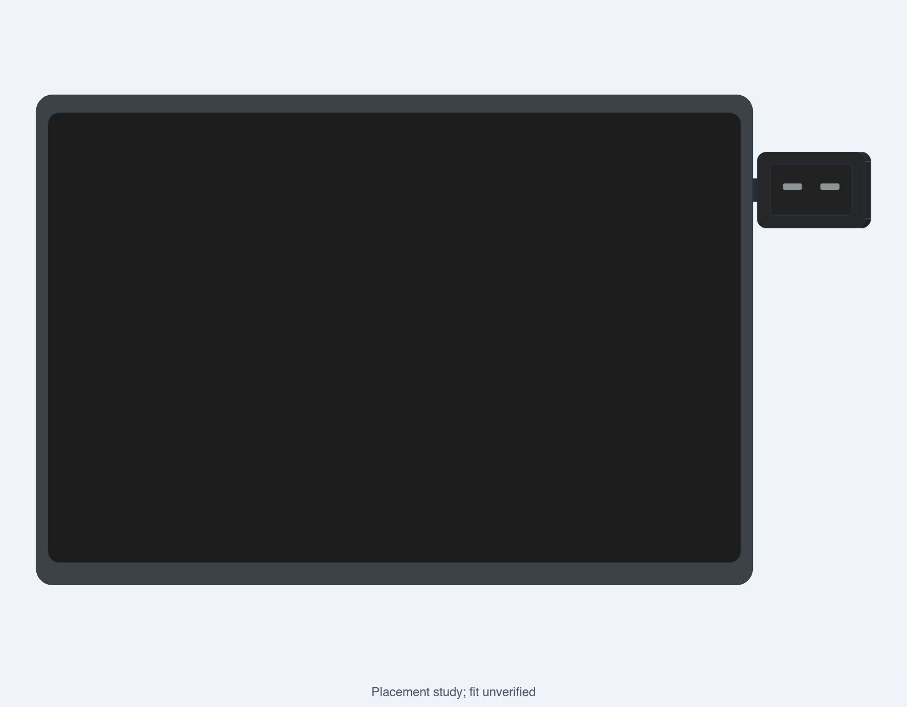
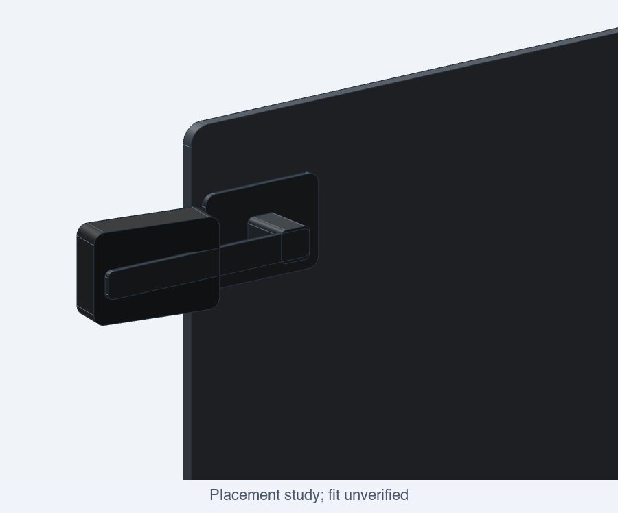

# MacDesk Buddy: the first build decision

Decision date: 2026-10-29. No hardware purchased or physical tests performed.

Buy **one Waveshare ESP32-S3-Touch-AMOLED-1.64, SKU 31197, V2**, and use a USB-C data cable you already own if possible. This is the selected board for a custom companion. It combines the display and controller, so the first bench build needs no soldering, loose display wiring, separate ESP32 or sensor purchase. The existing round-screen code will not drive it.

## What to buy

| Quantity | Item | Spend and selection |
|---|---|---|
| 1 | [Waveshare 1.64-inch AMOLED board, SKU 31197](https://www.waveshare.com/ESP32-S3-Touch-AMOLED-1.64.htm), V2 | Manufacturer reference $23.99 before delivery/tax. Match the full product name; avoid RP2350, ESP32-C6, round 1.32 and LCD variants. |
| 0 or 1 | USB-C to USB-C data cable | Test an existing cable first. For the desk prototype use a flexible straight cable, roughly 0.5-1 m; defer a right-angle plug until the final cable exit is measured. |
| Borrow initially | Digital caliper | Needed to measure the board, connector and Mac lid before the fitted case. |
| Small shared supply | Single-color PLA | Print the clearance coupon first. Prefer black for the later case if a suitable spool is available. |

[OpenELAB's listing for the same SKU](https://openelab.io/products/waveshare-esp32-s3-amoled-touch) displayed EUR 27.25 including VAT; its published shipping table lists EUR 7.95 for selected EU destinations. EUR 35.20 is their arithmetic reference, **not a Finland checkout quote**. Country tax, availability, revision and dispatch warehouse still need checking in the order. Its page contains mixed stock/warehouse signals, so do not assume immediate EU dispatch. [Opencircuit](https://opencircuit.shop/product/esp32-s3-1.64inch-amoled-touch-display) displayed EUR 35.25 before shipping and an availability date of November 11; that is a less attractive first choice today. Listings can change between page loads.

My suggested spending ceiling is **EUR 45 delivered for the board and cable**. This is a budget recommendation, not a verified price or an order authorization. If checkout exceeds it, keep the same board decision and wait for a better delivered offer. There is no reason to buy both the integrated board and the old EUR 40.03 GC9A01 parts basket.

Skip a battery, motors, camera, microphone, separate IMU, breadboard, jumper kit, speaker, microSD card and AI subscription for this build. The board's touch and IMU can be explored later without buying them separately.

## Quality and useful life

I interpret the quality requirement as documented, reusable hardware with a replaceable enclosure and a supportable software path. This board has published examples and schematics, and can later serve as a status display, timer, touch control or other ESP32 project. The screen and controller are integrated; replacing a failed panel may mean replacing the board.

Waveshare is a Chinese vendor. This recommendation does not establish non-Chinese manufacturing. There is also no verified service-life or failure-rate evidence for this board, so a promise that it will last a particular number of years would be invented. Buy from a seller with clear defect/return handling, test the board before enclosing it, and keep the order record.

Use USB power, modest brightness, moving expressions and automatic dimming/blanking when idle. AMOLED image retention remains a real design consideration for a face that could stay lit all day. Keep the board removable, avoid stressing its USB connector, and leave thermal clearance. These are design requirements; the current firmware does not implement AMOLED dimming or sleep. See the [engineering study](../reports/Rectangular%20buddy%20engineering%20study.md) for the supporting display references.

## The shape to keep

Use the selected **landscape head on the upper right side**, approximately 25 mm below the lid top, angled inward by 10 degrees. The head and fixed arm detach for transport; a thin rear dock stays behind. The modeled 2 mm side gap is provisional. The 48 x 33.12 x 13 mm body and assumed laptop lid dimensions establish appearance only.

The eyes in these CAD renders are geometric placeholders. The [approved face image](../assets/face-idle-240.png) remains the character reference; its [456 x 280 adaptation and deterministic preview](../firmware-v2/README.md) now preserve that identity for the landscape display. The render does not prove that the electronics, USB plug or attachment fit. The dock and arm shown have no working latch or tested adhesive interface. Remove the head before carrying the Mac; do not close the lid over an untested cable or fixture.

## What the software needs

The Mac supplies events and any optional intelligence. The ESP32 renders eyes, expressions and short text locally. This keeps ordinary reactions responsive without a model call, and lets the software evolve without replacing the display. A local model belongs on the Mac; no useful agentic language model is planned on the ESP32.

| Requested behavior | First implementation route | Status today |
|---|---|---|
| Expressive eyes, blink, happy/sleepy/thinking cues | Port approved face to selected landscape panel; animate locally | GC9A01 version plus separate V2 bench renderer; hardware untested |
| Touch interaction | Short tap action such as dismiss or change state | Hardware has touch; custom behavior unimplemented |
| Battery, connected devices, timers, nudges | Mac event adapters and bounded USB messages | Planned |
| Music reactions | Start with authorized track/playback metadata; amplitude/beat capture is separate | Planned |
| Lyrics, clips, downloads | One short lyric line from an allowed source; clips converted for the panel; explicit progress integration per app | Planned; no universal access assumed |
| ChatGPT/Codex and other app tokens | Supported hooks or a Buddy-owned agent workflow; define whether session usage or account quota | No general desktop-chat token adapter |
| Pretend to watch a movie or YouTube | Foreground-app/playback cue first; optional, permissioned screen capture later | Planned; no camera required |
| Laugh and feel alive | Local expression/animation timing; audible laughter would need extra audio hardware | Visual behavior planned; audio deferred |
| Small fast agent model | Optional Mac-local model returning allowlisted actions | No model selected or benchmarked |

This table records scope, not implemented features. Use the [architecture](architecture.md) for protocol and privacy boundaries. Internal or partner content must stay local. Do not scrape private desktop application stores as a substitute for supported integrations.

### Why the V2 port is a separate task

The [official V2 repository](https://github.com/waveshareteam/ESP32-S3-Touch-AMOLED-1.64-v2/tree/21b952243d306692774f3b5bfeb3eb5cff10f851) includes Arduino/ESP-IDF examples and schematics. Its Arduino display example bundles an `esp_lcd_sh8601` driver, while the product listing names CO5300. Driver naming alone does not identify the delivered panel. Use the exact revision's complete vendor initialization path and confirm it on the board; do not substitute a guessed driver.

The example uses QSPI, a panel X offset and software landscape rotation. The older round firmware uses Adafruit GC9A01A with a different bus, pins and asset layout. Adding a board name to PlatformIO would not supply a working V2 renderer. The [separate V2 bench project](../firmware-v2/README.md) now implements that path and an offline pixel-parity check. Keep the working round build as a reference until the new path shows the face on the actual board. Taby's V1 firmware is also unsuitable for V2.

## What to do next, in order

1. Order the one board after confirming exact SKU/revision, delivery to Finland, total cost and seller handling of defects. Reuse a data cable.
2. While it ships, confirm local permission to use the shared printer for this personal project. Use [the printing guide](printing.md) for the single-color fit coupon. It does not need the electronics.
3. On receipt, photograph the board marking, measure it and run the matching official display example on the desk. Confirm Mac USB enumeration and a readable screen before putting it in any case.
4. Port the renderer and USB protocol. Check all expressions, short text, rotation, dim/sleep, invalid and overlong commands, disconnect/reconnect and sustained operation. Record actual outcomes before enabling automatic events.
5. Measure the Mac lid and cable route. Replace the appearance placeholders with a fitted shell, board retention, removable cover, strain relief and a tested detachable interface. Print a fit piece before a complete housing.
6. Add timer and battery events, then one music or coding-tool integration. Add optional model decisions only after the deterministic companion is useful.

The purchase and appearance decisions are settled here. A fitted mount and physical validation of the selected-board firmware remain unfinished because no board has been bought or measured. The next work should validate this build, not reopen the screen comparison without evidence that the selected board fails a requirement.
